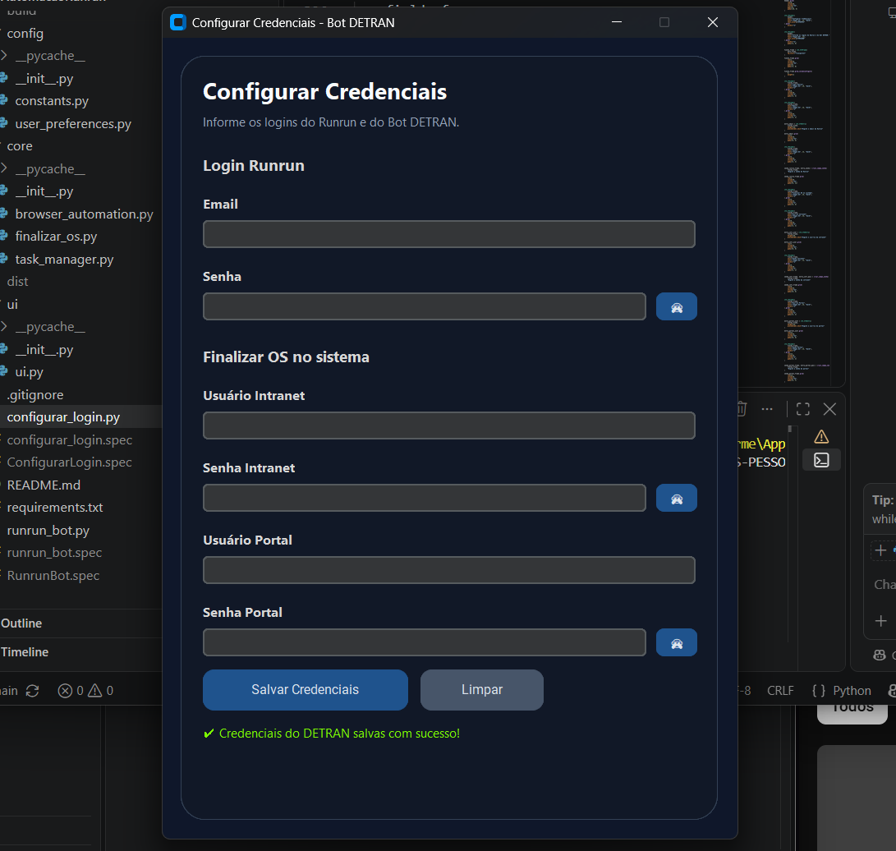
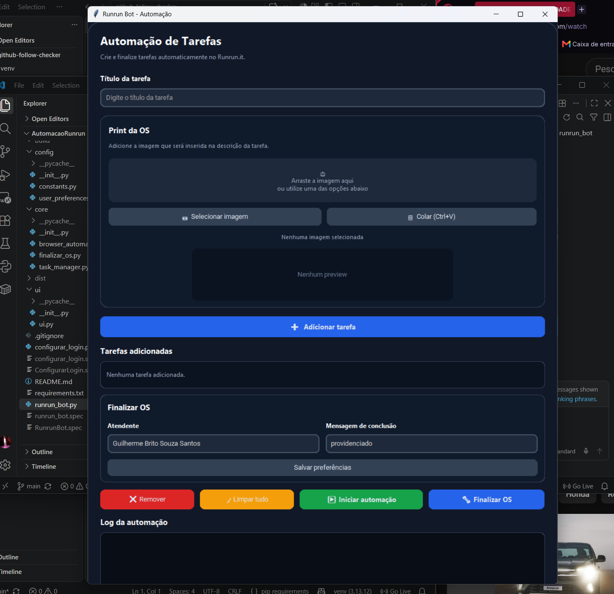

# AutomacaoRunrun
 
## Instalação e Compilação

### 1. Instalar as dependências

Na pasta do projeto, execute:

```bash
pip install -r requirements.txt
```

### 2. Instalar os componentes do Playwright

```bash
python -m playwright install
```

### 3. Gerar o `RunrunBot.exe`

```bash
pyinstaller --clean --onefile --windowed --name RunrunBot --collect-all playwright runrun_bot.py
```

### 4. Gerar o `ConfigurarLogin.exe`

```bash
pyinstaller --clean --onefile --windowed --name ConfigurarLogin configurar_login.py
```

Os executáveis serão gerados na pasta:

```text
C:\AutomacaoRunrun\dist\
```

## 📸 Screenshots

### Configuração de Login


### Runrun Bot

